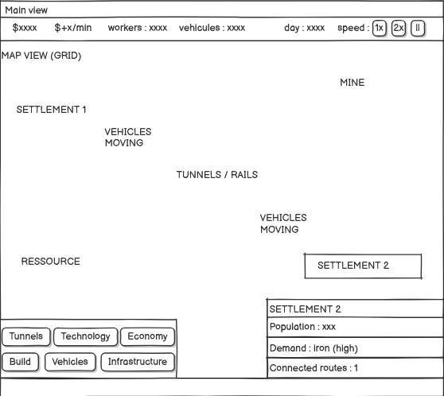

# Underground Transport Guild

A JavaFX desktop transport management simulation developed by Team 3 for Software Technology 2026. Build an underground network, connect settlements and industrial facilities, and manage transport while keeping the guild profitable.

## Key features

- Procedural 50 × 50 maps with settlements, mines, farms, forges, hazards, and starter tunnels.
- Tunnel construction, depot placement beside hubs, and infrastructure removal.
- Routes with multiple depot stops, visualization, renaming, and vehicle assignment.
- Cargo and passenger vehicles with purchase, upgrade, and sale actions.
- Production, changing settlement demand, loading/unloading, and delivery income.
- Maintenance expenses, financial summaries, low-balance warnings, and bankruptcy.
- Map panning, minimap navigation, selection details, and pause/1×/2×/4× controls.
- Five local save slots using Java object serialization.

Some UI elements remain unfinished; see Limitations below.

## Tech stack

| Component | Configuration |
| --- | --- |
| Language | Java 21 |
| Desktop UI | JavaFX Controls and FXML dependencies, 21.0.2; views built in Java |
| Build | Maven 3.9+; compiler plugin 3.13.0 |
| Tests | JUnit Jupiter 5.11.4; Surefire 3.5.4 |
| Launch | JavaFX Maven plugin 0.0.8 |
| Automation | GitHub Actions and original GitLab CI |

Versions are declared in [pom.xml](underground_guild/pom.xml). Maven resolves JavaFX and its platform libraries; no separate JavaFX SDK is required for the Maven launch command. No database, external API, credentials, or environment file is used.

## Project structure

```text
.
├── .github/workflows/ci.yml     # GitHub build and test workflow
├── .gitlab-ci.yml               # Original GitLab pipeline
├── underground_guild/
│   ├── pom.xml                  # Dependencies and launch configuration
│   └── src/
│       ├── main/java/team3/
│       │   ├── Main.java        # JavaFX entry point
│       │   ├── controller/      # Navigation and action delegation
│       │   ├── model/           # Map, transport, production, demand, economy
│       │   ├── service/         # Gameplay orchestration and clock
│       │   ├── persistence/     # Save-slot storage
│       │   ├── util/            # Application metadata
│       │   └── view/            # Screens, panels, map renderer
│       ├── main/resources/styles.css
│       └── test/java/team3/     # Model, service, palette, and UI tests
├── docs/                       # Historical issue notes and release review
├── Wireframe/                  # Original UI designs, not runtime screenshots
├── MILESTONE3_RAZA_PLAN.md      # Historical team planning
└── TODO_MILESTONE3_RAZA.md      # Historical milestone tracking
```

Historical notes describe earlier implementations and verification claims. Current source and release validation take precedence where they differ.

## Installation

1. Install JDK 21 and Maven 3.9+.
2. Set `JAVA_HOME` to the JDK directory and add Maven's `bin` to `PATH`.
3. Download or clone this repository. Open the root containing this README and `underground_guild/`.
4. Check versions and compile:

```sh
java -version
mvn -version
mvn -B -f underground_guild/pom.xml clean compile
```

Maven should report Java 21. The first build needs internet access for dependencies. Running the application requires a graphical desktop with JavaFX support.

## Usage

From the repository root:

```sh
mvn -f underground_guild/pom.xml javafx:run
```

1. Choose **New Game** for a map with starting funds of 10,000 and seeded depots/routes.
2. Select a build mode, then click a map tile. Tunnels cost 50; depots cost 500 and require a tunnel tile beside an existing hub.
3. Create a route by selecting depot stops in order and confirming its name. Stops need a valid tunnel connection.
4. Buy a vehicle, assign it to a route, and monitor deliveries and finances.
5. Use Save to select one of five slots. **Load Save** on the welcome screen restores a slot.

| Control | Action |
| --- | --- |
| Arrow keys / W A S D | Pan when the map has keyboard focus |
| Drag map / click minimap | Move the camera |
| 1 / 2 / 3 | Select 1× / 2× / 4× speed |
| 4 or P | Pause |

Saves live under the current user's home directory in `.underground-guild-saves/slot-1.ser` through `slot-5.ser`. Saving replaces that slot. Only load trusted saves: Java deserialization is unsuitable for untrusted file exchange.

## How it works

`Main` creates `GameService`, `AppController`, and the welcome scene. The controller switches screens, and views call the service for gameplay actions. `Game` holds the map, economy, clock, vehicles, routes, and movement state.

`MainGameView` schedules a callback every 100 ms, passing 0.1 seconds to `GameService.advanceSimulationFrame`. Time accumulates at the selected speed into whole simulation ticks. Each update advances the clock, produces goods, changes demand, moves vehicles, awards in-transit cargo income, deducts maintenance, and checks bankruptcy. Arrival handling unloads deliveries, awards income, and reloads cargo. Rendering uses the remaining fractional tick for interpolation.

`GameMap` uses breadth-first search across orthogonal tiles, starting and finishing at accessible hub boundaries. `Game` enforces single-unit tile occupancy. Distance progression and tile occupancy both contribute to the current movement implementation.

`SaveManager` serializes the `Game` object graph. Service-level delivery/maintenance subtotals and the fractional tick accumulator reset on load; economy totals in `Game` remain saved.

## Output and design assets

The application displays an interactive map and panels for routes, vehicles, infrastructure, and finances. Build output and test reports go to `underground_guild/target/`.

This image is an original **wireframe**, not a runtime screenshot:



No benchmarks or experimental performance results are included.

## Testing

```sh
mvn -B -f underground_guild/pom.xml test
mvn -B -f underground_guild/pom.xml clean verify
```

Existing tests cover map generation/connectivity, construction, routes, movement/occupancy, cargo/passengers, production/demand, economy, clock behavior, and UI helpers. `PanelButtonSmokeTest` needs the JavaFX toolkit and a graphical environment. Its existing assumption skips it when `CI=true`, as configured in GitHub Actions. A successful CI build therefore does not establish full interactive UI coverage.

For manual validation, launch the game, build a connection, assign a vehicle, change speeds, save/reload, and exercise bankruptcy and menu navigation. See [release readiness](docs/release-readiness.md) for actual checks and unresolved issues.

## Limitations

- Settings sliders have no persistent settings or audio integration.
- Technology research is a standalone UI state demonstration without gameplay effects or persisted research.
- Saves have no cross-version migration, input filter, or atomic replacement.
- UI vehicle descriptions differ from some model factory defaults.
- New maps vary randomly; model tests can inject seeded randomness.
- UI tests cover selected controls rather than complete gameplay/navigation flows.
- No installer or standalone distributable is provided; launch through Maven.

## Future improvements

Potential follow-up work: versioned and validated saves, persistence round-trip tests, consistent vehicle descriptions, settings/research integration, broader UI lifecycle tests, and platform-specific packaging. These are proposals, not implemented features.

## Attribution and license

Originally developed by **Team 3** for **Software Technology 2026**. Preserve team attribution and describe your individual portfolio contributions accurately. Original planning records and assets are retained.

No license has been selected. Confirm contributor permissions and course requirements before choosing a license or publishing.
